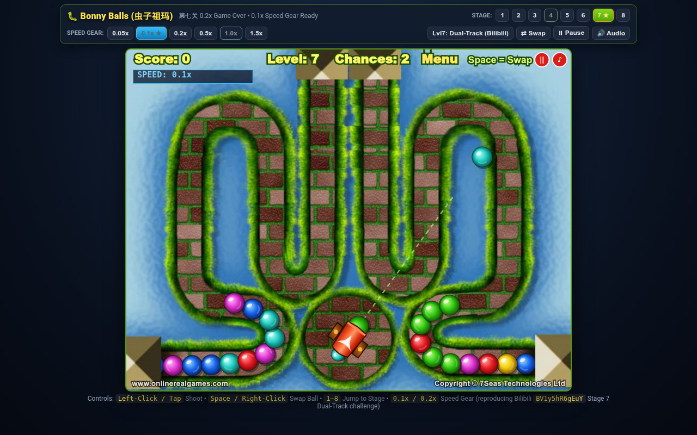

# Bonny Balls (`虫子祖玛`) — Authentic 8-Stage HTML5 Reproduction

**Live Playable Game (GitHub Pages):** [https://kunruiw1991.github.io/bonny-balls/](https://kunruiw1991.github.io/bonny-balls/)  
**Source Repository:** [https://github.com/kunruiw1991/bonny-balls](https://github.com/kunruiw1991/bonny-balls)



---

## 1. Background & Bilibili Video Reference

This repository provides a frame-accurate, zero-dependency HTML5 Canvas & Web Audio reproduction of **Bonny Balls** (widely known in Chinese Flash gaming communities as **`虫子祖玛`** / *Bug Zuma*), originally developed by **7Seas Technologies Ltd** (`www.onlinerealgames.com`, `650×500` @ `25 fps` SWF).

It directly reproduces and explains the infamous Stage 7 phenomenon documented in the Bilibili gameplay recording **[BV1y5hR6gEuY](https://www.bilibili.com/zh-Hans/video/BV1y5hR6gEuY/)**:

> **「虫子祖玛游戏录制，第七关0.2game over，看来第七关必须0.1，快一档都不行」**  
> *(Bug Zuma gameplay recording: Stage 7 Game Over at 0.2x speed — looks like Stage 7 strictly requires 0.1x, even one gear faster is impossible!)*

By decompiling the original ActionScript 2 bytecode (`Config.as`, `PathInfo.as`, `Game.as`, `Cannon.as`, `Ball.as`, `DropInfo.as`, `Star.as`, `Explode.as`) and extracting the exact vector spline paths, bitmap backdrops, foreground occlusion masks, and audio tracks from the original SWF, this project preserves both the authentic 8-stage campaign and a built-in **CheatEngine-style Speed Gear (`0.05x` / `0.1x` / `0.2x` / `0.5x` / `1.0x` / `1.5x`)** so players can experience and test the Stage 7 dual-track bottleneck firsthand.

---

## 2. Why Stage 7 Is Infamous (`0.2x Game Over` vs `0.1x Speed Gear`)

In Stages 1 through 6, the ball train travels along a **single `1,000`-point spline curve** (`ball0`). Even as the base movement speed increases linearly via `20 + 3 * (L - 1)`, the player has ~`1,000` spline points of track length to clear `80 + 5 * (L - 1)` balls, and the cannon enjoys relatively open firing angles across the map.

**Stage 7 changes the geometry and pressure completely:**

1. **Two Simultaneous ~500-Point Tracks (`ball0` Left + `ball1` Right):**
   - Instead of one `1,000`-point path, Stage 7 splits the brick road into **two independent, simultaneously advancing chains**:
     - **Left Track (`ball0`):** `501` spline points emerging from the bottom-left sandstone pyramid (`[37.85, 462.6]`), looping through the left brick rings, and racing into the top-left pyramid exit (`[288.7, 15.85]`).
     - **Right Track (`ball1`):** `517` spline points emerging from the bottom-right sandstone pyramid (`[625.9, 461.5]`), looping through the right brick rings, and racing into the top-right pyramid exit (`[363.4, 17.7]`).
   - Because each track is only **half the length (~`500` points instead of `1,000`)** while `baseMoveSpeed` has climbed to **`38` px/s** (`20 + 3 * 6`) and all **6 ball colors** are active (`110` balls total), the time-to-drain on *both* tracks simultaneously is cut in half.
2. **Initial `20%` Roll-In Surge (`STAGE_CREATE_PROPORTION = 20`):**
   - At stage start (`CREATE` phase), both chains surge out of the bottom pyramids at `BALL_CREATE_SPEED = 750` px/s until reaching `20%` of their track length (`pointIndex >= 100`), immediately placing both heads deep inside the upper-middle loops.
3. **Boxed-In Cannon Inside the Bottom-Center Brick Ring (`(324.25, 426.9)`):**
   - The rotating cannon sits at `(324.25, 426.9)`, tightly enclosed inside the bottom-center circular brick loop.
   - Shots aimed at the upper-left or upper-right pyramid approaches are physically blocked whenever the lower brick ring fills with balls, forcing the player to constantly punch holes through the inner ring or alternate rapidly between left and right chains before either head crosses `pointIndex = 480` / `496` (the pyramid entrance `cannotHit` zone).
4. **Why `0.2x` Still Triggers Game Over While `0.1x` Survives:**
   - Because Cannon reload cooldown (`BALL_SHOOT_INTERVAL = 200ms`) and projectile flight speed (`BALL_SHOOT_SPEED = 1400` px/s) must service **two short 6-color tracks through a blocked inner ring**, playing at `1.0x`—or even slowing the game down to `0.2x`—still allows one of the two chains to slip past the top-center pyramid threshold whenever color RNG produces non-matching front/back cannon balls. Dropping one gear further to **`0.1x`** gives the necessary aiming and clearing margin to keep both left and right chains away from the top pyramids.
   - *(Note: We also include a toolbar toggle for the alternate single-arch `1,000`-point Stage 7 variant (`Lvl7: Single-Arch`) alongside the default `Lvl7: Dual-Track (Bilibili)` mode.)*

---

## 3. Complete 8-Stage Campaign Specification

All 8 stages follow the exact formulas from `Config.as` and `Game.as`:
- **Total Balls per Stage:** `maxNoOfBalls = 80 + 5 * (L - 1)`
- **Base Chain Speed:** `baseMoveSpeed = 20 + 3 * (L - 1)` (px/s along spline)
- **Active Ball Colors:** `5` colors on Stages 1–3 (`Red`, `Blue`, `Green`, `Yellow`, `Pink`); all `6` colors on Stages 4–8 (adds `Cyan`)

| Stage | Cannon `(x, y)` | Cannon Mode | Track Count & Spline Points | Ball Count (`80+5(L-1)`) | Base Speed (`20+3(L-1)`) | `cannotHit` Range(s) | Foreground Overlays & Stage Features |
| :---: | :---: | :---: | :---: | :---: | :---: | :---: | :--- |
| **1** | `(321.35, 243.10)` | 360° Rotating | `1` track (`1,000` pts) | `80` | `20` | `[-1, -1]` | Green caterpillar head at top-right entrance (`[603.85, 94.55]`); central spiral pit at `[378.4, 205.3]`. |
| **2** | `(321.35, 243.10)` | 360° Rotating | `1` track (`1,000` pts) | `85` | `23` | `[-1, -1]` | Green caterpillar head at top-left entrance (`[146.65, 68.1]`) + blue bug head at center-right exit (`[460.25, 233.0]`). |
| **3** | `(227.55, 202.10)` | 360° Rotating | `1` track (`1,000` pts) | `90` | `26` | `[-1, -1]` | Green caterpillar head at bottom-right entrance (`[539.7, 461.95]`) + blue bug head at inner spiral exit (`[372.1, 245.65]`). |
| **4** | `(307.55, 467.00)` | **Horizontal Sliding** (`y=467`, aims `-90°` up) | `1` track (`1,000` pts) | `95` | `29` | `[29, 976]` | **Wooden tunnel roof (`lvl4_tunnel.png`)** occluding top-left entrance & exit (`[7.95, 19.9]`); swimming pool, lilies, flower & beach umbrella decals. |
| **5** | `(83.50, 405.45)` | 360° Rotating | `1` track (`1,000` pts) | `100` | `32` | `[22, 980]` | **Sandstone pyramids** at top-right entrance (`[584.6, 73.55]`) and center-left exit (`[32.55, 276.1]`) rendered over balls. |
| **6** | `(287.55, 314.10)` | 360° Rotating | `1` track (`1,000` pts) | `105` | `35` | `[22, 980]` | **Sandstone pyramids** at bottom-left entrance (`[34.7, 442.2]`) and top-right exit (`[602.55, 72.85]`) over winding figure-8 road. |
| **7** | `(324.25, 426.90)` | 360° Rotating *(Boxed in bottom ring)* | **`2` tracks** (`501` pts Left + `517` pts Right) | `110` | `38` | `[22, 480]`, `[22, 496]` | **Dual-Track Brick Loops:** Bottom-left (`[37.85, 462.6]`) & bottom-right (`[625.9, 461.5]`) entrance pyramids racing into dual top-center exit pyramids (`[288.7, 15.85]` & `[363.4, 17.7]`). |
| **8** | `(321.85, 464.20)` | **Horizontal Sliding** (`y=464.2`, aims `-90°` up) | `1` track (`1,000` pts) | `115` | `41` | `[5, 950]` | **Stone bunker roof (`lvl8_bunker.png`)** occluding bottom-left exit (`[-19.3, 335.55]`) over multi-tier horizontal serpentine highway. |

---

## 4. Decompiled ActionScript 2 Engine Architecture

Every gameplay subsystem in `game.js` and `paths.js` is ported 1:1 from the decompiled ActionScript 2 classes:

- **`Config` (`Config.as`):**
  - Core physical constants: `BALL_RADIUS = 15` (`30px` diameter), `BALL_CONNECT_TOLERANCE = 5`, `BALL_SHOOT_SPEED = 1400` px/s, `BALL_SHOOT_INTERVAL = 0.2` s (`200ms`), `BALL_INSERT_TIME = 0.1` s (`100ms`), `BALL_CREATE_SPEED = 750` px/s, `BALL_DROP_ACCELERATION = 1000` px/s², `BALL_LOSE_SPEED = 1500` px/s, and `BALL_SAME_POSSIBILITY = 0.2`.
  - Per-stage occlusion and collision masks (`STAGEBACKGROUND_BALLMASKS` and `STAGEBACKGROUND_BALLCANNOTHITS`) preventing shots from hitting balls still inside entrance/exit tunnels or pyramids.
- **`PathInfo` (`PathInfo.as`):**
  - Computes `maxPointSpacing` across the polyline and derives `ballSpacing = (BALL_RADIUS * 2) / maxPointSpacing` (`30 / maxPointSpacing`) and `connectedBallSpacing = (BALL_RADIUS * 2 + BALL_CONNECT_TOLERANCE) / maxPointSpacing` (`35 / maxPointSpacing`).
  - Provides continuous fractional spline interpolation (`getXY(pointIndex)`), tangent orientation (`getAngle(pointIndex)`), and tunnel collision gating (`getCannotHit(pointIndex)`).
- **`Cannon` (`Cannon.as`):**
  - Supports both **360° rotational aiming** (`Stages 1, 2, 3, 5, 6, 7`) and **horizontal rail sliding** (`Stages 4 & 8`, where `cannon.x` tracks `mouseX` across `[42, 608]` while firing straight up at `-90°`).
  - Features dual-ball preview (`frontType` at the muzzle + `backType` in the chamber) with instant **Spacebar / Right-Click swapping** (`swapBalls()`) and color filtering so newly generated balls only sample colors still present on the board once `noOfBallsCreated >= maxNoOfBalls`.
- **`Ball` & `Game` (`Ball.as`, `Game.as`):**
  - **`doCreateMove`:** Rapid initial roll-in at `750` px/s until the lead ball reaches `20%` of the track.
  - **`pushBalls`:** Contiguous chain推進—pushing from the tail (`index 0`) forward wherever adjacent balls are within `connectedBallSpacing`, while stalled front segments remain stationary until caught up or pulled back.
  - **`landBallOnPath` & `checkDestroy`:** Projectile-to-chain collision detection (`dist <= 30px` on hittable balls), before/after tangent projection, `100ms` smooth insertion interpolation, and 3+ contiguous color matching.
  - **Scoring & Random Match Bonuses (`randomb`):** Base match score `count * 30 + (count - 3) * 40 + combo * 50`, plus random bonus popups (`$200`, `$400`, `$500`, `$600`, `Slow`, `Move Back!`).
- **`DropInfo` (`DropInfo.as`) — Magnetic Reverse Pull-Back & Chain-Reaction Combos:**
  - Whenever a middle segment is destroyed or a gap forms between two segments that share the **same color** at the gap boundary (`line[idx].type === line[idx - 1].type`), a `DropInfo` instance accelerates the front segment backward (`speed -= 1000 * dt`).
  - Upon colliding with the rear segment, `checkDestroy` triggers automatically with `combo + 1`, awarding chain-reaction combo bonuses and pushing the rear segment backward.
- **`Star` (`Star.as`) — End-of-Stage Bonus Trail:**
  - When all `maxNoOfBalls` balls have been spawned and destroyed (`ballLines` empty), bonus stars spawn every `STAR_SPACING = 30` px from the last destruction point (`lastDestroyPointIndexes`) to the end of the track, awarding `+10` points per star before advancing to the next stage.

---

## 5. Controls, Speed Gear & `window.__BONNY_BALLS__` Automation API

### Player Controls
- **Aim & Shoot:** Move mouse (or tap on touchscreens) and **Left-Click** to fire.
- **Swap Active/Next Ball:** Press **`Space`**, **Right-Click**, or click the **`⇄ Swap (Space)`** toolbar button.
- **Stage Selector (`1`–`8`):** Click any stage button in the top bar (or press keys **`1`–`8`**) to jump directly to that stage.
- **Stage 7 Mode Toggle:** Switch between **`Lvl7: Dual-Track (Bilibili)`** (the two-chain pyramid stage from BV1y5hR6gEuY) and **`Lvl7: Single-Arch`**.
- **Speed Gear (`0.05x` – `1.5x`):** Click **`0.05x`**, **`0.1x`**, **`0.2x`**, **`0.5x`**, **`1.0x`**, or **`1.5x`** in the top bar at any time to scale ball movement and roll-in speed in real time.
- **Pause / Mute / Restart:** Press **`P`** to pause, **`M`** to mute/unmute audio, or **`R`** to restart the current stage.

### Deterministic Test & Automation API (`window.__BONNY_BALLS__`)
For automated browser verification, headless Chrome (`gbrowser` / Playwright / Puppeteer) testing, and speedrun analysis, the engine exposes `window.__BONNY_BALLS__`:

```javascript
// Jump to Stage 7 and reset score/chances
window.__BONNY_BALLS__.loadLevel(7, true);

// Set Speed Gear to 0.1x (as required in BV1y5hR6gEuY)
window.__BONNY_BALLS__.setSpeedGear(0.1);

// Toggle Stage 7 track layout ('bilibili' for Dual-Track, 'arch' for Single-Arch)
window.__BONNY_BALLS__.setLevel7Mode('bilibili');

// Advance physics deterministically by dt seconds and render
window.__BONNY_BALLS__.step(3.5);

// Swap front and back cannon balls
window.__BONNY_BALLS__.swapBalls();

// Aim and fire immediately at logical stage coordinates (0..650, 0..500)
window.__BONNY_BALLS__.shootAt(324, 260);

// Inspect complete live state snapshot
const snapshot = window.__BONNY_BALLS__.getState();
console.log(snapshot);
// {
//   screen: 'PLAYING',
//   phase: 'PLAY',
//   currentLevel: 7,
//   level7Mode: 'bilibili',
//   score: 0,
//   chances: 2,
//   speedGear: 0.1,
//   lineCount: 2,
//   lineLengths: [20, 20],
//   noOfBallsCreated: 40,
//   maxNoOfBalls: 110,
//   cannon: { x: 324.25, y: 426.9, sliding: false, ... }
// }
```

### Running Locally
No build step or external dependencies are required. Serve the static directory over HTTP:

```bash
python3 -m http.server 18923 --bind 127.0.0.1
# Open http://localhost:18923/
```
